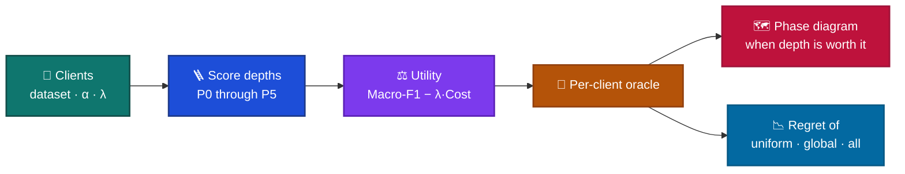

# ⚖️ When Is Personalized Federated Learning Worth Its Deployment Cost?

**A utility phase diagram for personalization depth**

[](https://ubmk.org.tr/)
[](https://ubmk.org.tr/)
[](paper/ubmk2026_camera_ready.pdf)
[](requirements.txt)
[](LICENSE)

> Fixed personalization policies leave regret on the table. The right depth depends on the dataset, heterogeneity, and how expensive adaptation is.

## 🏛️ Conference

| | |
| --- | --- |
| 🎤 Event | **11th International Conference on Computer Science and Engineering (UBMK 2026)** |
| 🇹🇷 Ad | 11. Uluslararası Bilgisayar Bilimleri ve Mühendisliği Konferansı |
| 📅 Dates | **16–18 September 2026** |
| 📍 Venue | Istanbul Beykent University, Taksim Campus, Istanbul, Türkiye |
| 🔗 Site | [ubmk.org.tr](https://ubmk.org.tr/) |

## 👥 Authors

| | | |
| --- | --- | --- |
| 🎓 **Beyazıt Bestami Yüksel** | Istanbul Technical University | yukselbe18@itu.edu.tr |
| 🎓 **Ayşe Yılmazer Metin** | Istanbul Technical University | yilmazerayse@itu.edu.tr |
| 🎓 **Emrah Dikbıyık** | Marmara University | emrah.dikbiyik@marmara.edu.tr |

## 📄 Paper

Camera-ready PDF: [`paper/ubmk2026_camera_ready.pdf`](paper/ubmk2026_camera_ready.pdf)

**When Is Personalized Federated Learning Worth Its Deployment Cost?**

Each client chooses a depth \(a \in \{P_0,\ldots,P_5\}\) under

\[
U_i(a)=\mathrm{Macro\text{-}F1}_i(a)-\lambda\,\mathrm{Cost}_i(a).
\]

\(P_0\) keeps the global model. \(P_5\) adapts the full local network. The oracle picks the depth with the highest utility. This repository characterizes that oracle. It does not introduce a new federated optimizer.

Mean regret against the oracle, across the shipped validation table:

| 📌 Fixed policy | 📉 Mean regret | 📈 Relative regret | 🏆 Oracle win rate |
| --- | ---: | ---: | ---: |
| 🎲 Random | 0.3181 | 189.3% | 100% |
| 📏 Best uniform | 0.0273 | 6.5% | 82% |
| 🌍 Global-only | 0.1223 | 28.2% | 83% |
| 📣 Personalize-all | 0.6407 | 409.0% | 99% |

Best uniform is the serious baseline. Personalize-all is far from the oracle. Which gap is largest depends on the dataset, Dirichlet heterogeneity \(\alpha\), and cost sensitivity \(\lambda\).

## 🗺️ From federation to phase diagram



## 🗂️ What is in this repository

```
fedpbg/     data splits, FedAvg, P0–P5, cost, utility, oracle
scripts/    feasibility, phase diagram, regret, Ditto, figure rebuild
results/    paper tables and short summaries
paper/      camera-ready PDF
```

Draft manuscripts, the arXiv source bundle, IEEE templates, and local datasets are not in this repository.

## 🚀 Run

```bash
python -m venv .venv
# Windows: .venv\Scripts\activate
# Linux/macOS: source .venv/bin/activate
pip install -r requirements.txt
```

CIFAR-10/100 download through torchvision. For ECG runs, place [PTB-XL 1.0.3](https://physionet.org/content/ptb-xl/1.0.3/) at `data/ptbxl/`.

```bash
python scripts/run_feasibility.py --quick
python scripts/run_sparsity_phase_diagram.py
python scripts/run_oracle_regret_study.py
python scripts/run_ditto_evaluation.py
python scripts/regen_ubmk_camera_ready_figures.py
```

Shipped tables already live under `results/`. Full grids are the long path and prefer a GPU. Figure scripts write PNGs to `paper/figures/`.

## 📜 License

Code is released under the [MIT License](LICENSE). The manuscript PDF is the authors’ scholarly work.
